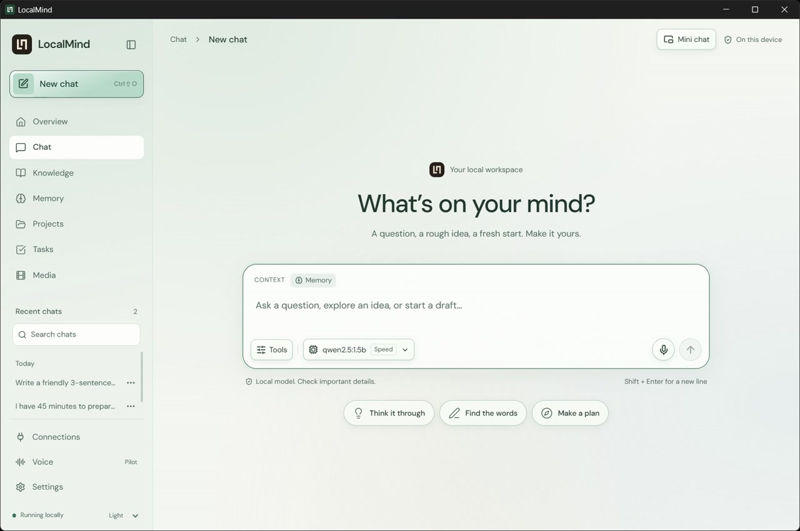

  

# LocalMind

**Your models. Your files. Your workspace.**

LocalMind is a desktop app for chatting with local AI, exploring your documents, and keeping useful context close. Run it in a full workspace or keep a small, pinned chat beside what you are doing. No LocalMind account or cloud AI subscription is required for local chat.

[Download](https://github.com/Swarneil1905/LocalMind/releases/latest) · [Watch the walkthrough](https://swarneil1905.github.io/LocalMind/) · [Get started](#get-started) · [Development](#development) · [Report a bug](https://github.com/Swarneil1905/LocalMind/issues)

## See it in action

**[Watch in your browser, with playback and fullscreen controls →](https://swarneil1905.github.io/LocalMind/)**

The captioned walkthrough shows the 0.8.0 desktop release candidate in a separate demo profile: full-window chat, live local-model responses, follow-up questions, model/context controls, and mini chat. The walkthrough is edited for length; model responses are shown as generated. Experimental features are identified rather than presented as validated production features.

## What you can do

| Feature | In the app |
| --- | --- |
| **Chat locally** | Stream responses through Ollama. Read formatted code, tables and equations; copy, stop or retry answers. |
| **Choose your model** | Switch response presets from the composer; configure their models in Settings. Adjust context and supported thinking controls in Settings. |
| **Keep a mini chat nearby** | Resize, pin, minimize or expand the current conversation without losing its draft. |
| **Ask your documents** | Add folders to Knowledge, assign them to projects, and inspect cited passages with page or line locations. |
| **Remember useful context** | Review and remove saved facts. New memories are scoped to a project or their originating conversation. |
| **Organize work** | Group chats into projects and manage tasks. Chat-proposed tasks require review before creation. |
| **Check online sources** | Turn Web on for source-dependent questions. Inspect links and available publication dates. |
| **Track dependencies** | Record which files or tasks depend on a fact, rescan for changes, and review repair previews. File apply/restore is a Windows pilot with recovery receipts. |
| **Explore media** | Review optional Runway video requests before upload and payment. Track jobs, recover known tasks and save verified outputs. Live provider acceptance is pending. |

Light, dark and system themes use calm backgrounds, subtle spotlight surfaces and glass-style actions. Keyboard focus stays visible; reduced-motion preferences are respected.

LocalMind supports **independent desktop installations**. Each person has their own profile, models and connections. Shared accounts, hosted team workspaces and automatic device sync are not available.

## Install

**[Open the latest release](https://github.com/Swarneil1905/LocalMind/releases/latest)** and choose your installer. This branch targets **0.8.0**; the release page is the source of truth for published installers. Read the [0.8.0 release notes](docs/releases/v0.8.0.md).

| Platform | Download |
| --- | --- |
| Windows x64 | `LocalMind_0.8.0_x64-setup.exe` |
| macOS Apple Silicon, macOS 14+ | `LocalMind_0.8.0_aarch64.dmg` |
| macOS Intel, macOS 14+ | `LocalMind_0.8.0_x64.dmg` |
| Linux x64 | `.deb` or `.AppImage` |

The installer includes the Python AI service and Ollama runtime. You do not need Python, Node.js, Rust or Docker to use the app. An existing local Ollama installation can be reused. **Model weights download separately.** Memory use, disk space and speed depend on your model and computer.

Updater bundles are signed with LocalMind's update key. Windows installers are not Authenticode-signed and macOS apps are not Apple-notarized, so operating systems may display a security prompt. Release assets include `SHA256SUMS.txt`.

## Get started

1. **Finish model setup.** Download a model. Start with the compact option if memory is limited.
2. **Ask a question.** Choose a response preset from the composer. Follow up in the same chat to keep context.
3. **Add your documents.** In Knowledge, add a folder and assign its project. Enable Knowledge in the matching chat; open citations to inspect source passages.
4. **Review Memory.** Keep useful facts and remove anything you do not want reused.
5. **Use Web when needed.** Enable it from Tools. Online queries leave the device; local explanations do not require search.

| Default model | Purpose | Approximate download |
| --- | --- | --- |
| `qwen2.5:1.5b` | Speed preset and lightweight background work | 1 GB |
| `qwen3:8b` | Balanced preset | 5.2 GB |
| `nomic-embed-text` | Semantic document search | 274 MB |

Once models are installed, local chat and retrieval can work offline. Exact-text Knowledge search remains available when embeddings fail. Local models can still be incorrect, miss context or invent details. Check important claims and cited sources.

### Everyday controls

- **Enter** sends; **Shift + Enter** adds a line break.
- **Tools** toggles Memory, Knowledge and Web. Active context appears above the draft.
- **Ctrl/Cmd + Shift + M** switches between full-window and mini chat while the app is focused.
- **Ctrl/Cmd + Shift + O** starts a new chat.
- Reading older messages keeps your position; **Latest response** returns to the current reply.

## Optional and experimental features

| Feature | Current boundary |
| --- | --- |
| **Local images** | Disabled by default after SSD-1B failed visual-quality review. Optional CUDA worker, separate runtime and approximately 4.16 GiB model download. No automatic paid fallback. |
| **Runway video** | Your own API key, native credential storage and per-request upload/cost approval. Local $50 monthly reservation limit; unknown submissions are never silently retried. Real provider acceptance remains pending. |
| **Voice** | Windows x64 English pilot: whisper.cpp transcription and installed system voices. Disabled by default pending human microphone/playback checks. Mac/Linux voice is not implemented. |
| **Gmail** | Read-only access with OS-stored credentials and bounded snippet sync. Fresh authorization required; live-account acceptance pending. |
| **MCP and plugins** | An explicitly enabled, owned MCP test server, built-in planner and synthetic repair recipe. No arbitrary third-party code or automatic chat tool execution. |
| **WhatsApp / iMessage** | Unavailable pending provider acceptance. |

Setup and limitations: [Media](docs/media.md) · [Voice](docs/voice.md) · [Connections and tools](docs/connections.md) · [Image research](docs/image-research.md).

## Your data

The desktop app talks to an authenticated local service on loopback. LocalMind has no built-in analytics or usage tracking.

| Activity | Destination |
| --- | --- |
| Local chat, memory, projects and tasks | Your device; SQLite profile databases |
| Document indexing and retrieval | Your device; SQLite and LanceDB |
| Web search | Search provider and retrieved websites; queries may include follow-up context |
| Connected services | The service you authorize; downloaded data remains in your profile |
| Runway video | Reviewed image and prompt go to Runway only after confirmation |
| Model/runtime downloads | Ollama or the documented model/runtime host |
| Update checks | GitHub Releases |

Gmail and Runway credentials use the native OS credential store with no plaintext fallback. Workspace databases are protected by OS account permissions, **not application-level encryption**. People sharing an OS account share its default profile.

| Platform | Default data directory |
| --- | --- |
| Windows | `%APPDATA%\LocalMind` |
| macOS | `~/Library/Application Support/LocalMind` |
| Linux | `$XDG_DATA_HOME/LocalMind`, or `~/.local/share/LocalMind` |

Ollama stores models separately. See [desktop runtime and storage](docs/DESKTOP_RUNTIME.md) before moving or backing up a profile.

## Troubleshooting

| Problem | Next step |
| --- | --- |
| AI service will not start | Use Retry. Close another LocalMind instance using the same profile. |
| Windows setup cannot write `localmind-sidecar.exe` | Close LocalMind and mini chat, then choose Retry. If an older version left a background service running, restart Windows and run setup before opening LocalMind. Do not choose Ignore: that can leave a mixed-version installation. |
| Model unavailable or responses slow | Complete its download or select a smaller model. Check memory and supported thinking settings. |
| Knowledge is incomplete | Inspect indexing status and permissions, then retry. PDFs need selectable text; OCR and automatic file watching are not implemented. |
| Source changed or disappeared | Citations show indexed passages. Reindex to refresh; older citations may no longer resolve afterward. |
| Current information cannot be verified | Enable Web and use a more specific query. Missing dated evidence should be reported, not invented. |
| Media task is paused or unknown | Follow its receipt. Resume only a known provider task; check Runway before replacing an unknown submission. |

Knowledge supports UTF-8 text/code and selectable-text PDFs, up to 10 MiB per file, 500 pages per PDF, 2,000 supported files and 20,000 passages per folder. Hidden and common build folders are skipped.

For [bug reports](https://github.com/Swarneil1905/LocalMind/issues), include version, OS, model, steps and relevant errors. Remove private content and credentials. Use [SECURITY.md](SECURITY.md) for vulnerabilities.

## Development

The stack is React/TypeScript, Tauri/Rust, Python/FastAPI, SQLite/LanceDB and Ollama. CI uses **Node.js 22, pnpm 11.0.9, Python 3.11 and Rust stable**. Native builds need the [Tauri prerequisites](https://v2.tauri.app/start/prerequisites/). Start with the [desktop development guide](apps/desktop/README.md). Docker is not required.

| Directory | Responsibility |
| --- | --- |
| `apps/desktop/src` | Interface and frontend tests |
| `apps/desktop/src-tauri`, `crates/` | Native commands, lifecycle, permissions and runtime |
| `services/ai` | Inference orchestration, retrieval, persistence and service tests |
| `scripts/media` | Optional isolated image worker |
| `scripts/release` | Packaging, payload checks, signatures and publication |
| `scripts/evaluation`, `evaluation/` | Conversation and model evaluation |
| `docs/watch` | Browser video player published through GitHub Pages |

Frontend, Python and Rust checks run on `main` and pull requests. Releases repeat those checks, build on native Windows/macOS/Linux runners, test installer payloads and verify assets before publication. See [Releasing LocalMind](docs/RELEASING.md).

Evaluation examples and replay runs do **not** train the model. See [conversation evaluation](evaluation/README.md) and [dataset preparation](evaluation/DATASETS.md). Local working notes, datasets and experiment reports stay outside tracked source.

LocalMind uses the [MIT License](LICENSE). Dependencies and downloaded models retain their own licenses.
